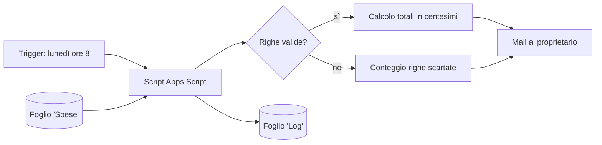

# Report settimanale delle spese (Google Apps Script)

Script che legge un foglio di spese, calcola i totali della settimana e li invia per mail ogni lunedì.
Pensato come esempio di automazione **sicura e verificabile** su dati finanziari.

> Tutti i dati nel progetto sono **inventati**. Non usare dati reali.

## Cosa fa

- Legge il foglio `Spese` (Data, Categoria, Descrizione, Importo).
- Somma le spese degli ultimi 7 giorni, in totale e per categoria.
- Invia il riepilogo **solo all'account proprietario** dello script.
- Segnala le righe con data o importo non validi, invece di ignorarle in silenzio.
- Scrive ogni esecuzione nel foglio `Log`.

## Flusso dei dati

## Installazione

1. Crea un Google Sheet e apri **Estensioni > Apps Script**.
2. Incolla `Code.gs` e il contenuto di `appsscript.json` (da Impostazioni progetto, attiva "Mostra il file manifest").
3. Esegui `generaDatiEsempio` per creare i dati finti, poi `inviaReportSettimanale`.
4. Esegui `installaTrigger` una volta per l'invio settimanale automatico.

## Sicurezza

### Permessi richiesti (OAuth scopes) e perché

| Permesso | Perché serve |
|---|---|
| `spreadsheets.currentonly` | Leggere e scrivere **solo** il foglio a cui lo script è collegato, non tutto Drive |
| `script.send_mail` | Inviare il report. Il destinatario è fisso (il proprietario) |
| `userinfo.email` | Conoscere l'indirizzo del proprietario, per il destinatario e per il log |
| `script.scriptapp` | Creare il trigger settimanale |

Principio del privilegio minimo: lo script **non** legge Gmail, **non** accede a Drive e **non** può inviare mail a indirizzi scelti da altri.

### Dati

- Il foglio contiene solo dati di esempio. Nessun dato personale.
- Il foglio `Log` registra quando, chi, azione e numero di righe. **Mai** importi o descrizioni.
- Nessuna chiave o credenziale nel codice (non servono). Il file `.gitignore` esclude comunque file di credenziali.

### Rischi considerati

| Rischio | Misura |
|---|---|
| Invio di dati a terzi | Destinatario fisso, non configurabile |
| Testo malevolo nel foglio (es. `<script>`) | Escape dell'HTML prima di costruire la mail |
| Errori di arrotondamento sui soldi | Calcolo in centesimi interi |
| Righe errate che falsano il totale | Conteggio e avviso nella mail |
| Errori silenziosi | Ogni esecuzione e ogni errore vanno nel `Log` |

### Limiti (da dichiarare)

- Il `Log` sta nello stesso foglio: chi può modificare il foglio può modificare il log. Per un vero audit servirebbe un log non modificabile (es. Cloud Logging).
- Se il foglio viene condiviso, chiunque abbia accesso in scrittura può cambiare i dati del report.
- Prima autorizzazione: Google mostra l'avviso "app non verificata", normale per script personali.

## Possibili miglioramenti

- Soglie di allarme (es. avviso se una categoria supera un budget).
- Report mensile e confronto con la settimana precedente.
- Log scritto anche su un sistema esterno non modificabile.
